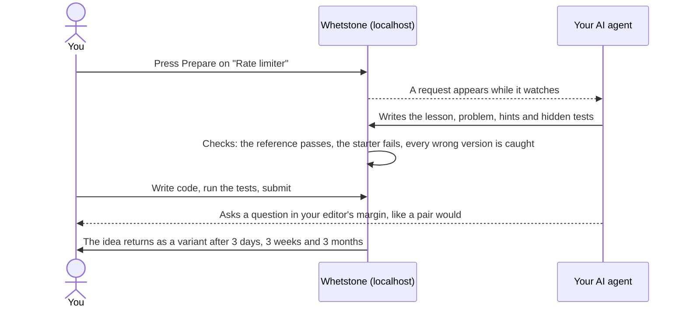

<div align="center">


<h1>Whetstone</h1>

<p><strong>Your AI writes the code. Whetstone keeps you sharp.</strong><br>
A self-hosted practice app where your own AI agent writes the lessons, and real tests grade your work.</p>

<p>
<a href="https://github.com/boffti/whetstone/actions/workflows/ci.yml"></a>
<a href="https://github.com/boffti/whetstone/actions/workflows/codeql.yml"></a>
<a href="https://scorecard.dev/viewer/?uri=github.com/boffti/whetstone"></a>
<a href="LICENSE"></a>

<br>


<a href="CONTRIBUTING.md"></a>
</p>

<p>
<a href="#why-whetstone">Why Whetstone</a> ·
<a href="#quick-start">Quick start</a> ·
<a href="#how-to-use-it">How to use it</a> ·
<a href="#screenshots">Screenshots</a> ·
<a href="#features">Features</a> ·
<a href="#roadmap">Roadmap</a> ·
<a href="CONTRIBUTING.md">Contributing</a>
</p>


</div>

## Why Whetstone

AI now writes most of our code, and the code still ships. What fades is the work it took over: recalling an idea without looking it up, reading code closely, finding a bug, writing the test that catches it, and holding a whole system in your head. You notice the day the AI is wrong and you can't tell.

Whetstone is where you practise those skills. Pick a system you'd like to understand, such as a payment processor, a matching engine, or an LLM gateway like OpenRouter. Your own AI agent (Claude Code, Codex, Cursor or another) writes each step for you, based on your job and your gaps. Real pytest suites grade your code. Ideas you solve come back as new variants until they stick.

It isn't interview cramming. Real interview reports keep the problems realistic, but the goal is staying sharp at work.

## What you practise

| What your AI does for you | What you practise in Whetstone |
|---|---|
| Writes the code | **Build** questions: the problem comes first; the lesson opens after your first try |
| Explains code you didn't write | **Predict** questions: read working code and say what it does before you run it |
| Finds the bug | **Fix** questions: a bug report with symptoms, never the cause |
| Reviews its own pull request | **Review** questions: find the defects planted in plausible AI-written code |
| Writes the tests | **Tests** questions: your tests must catch hidden bugs you never see |
| Sketches the architecture | **Design** questions: draw it on a whiteboard, and your agent grades it against a rubric |

## Quick start

You need Docker and an AI coding agent that can run commands in a folder.

```bash
git clone https://github.com/boffti/whetstone && cd whetstone
cp .env.example .env
docker compose up -d --build        # then open http://localhost:8000
claude                              # or codex, or open the folder in Cursor
```

Open `http://localhost:8000` in a browser pane next to your agent, such as the built-in browser in Claude's desktop app, or in any browser tab. If something doesn't work, run `bin/whetstone doctor`: it checks your setup and says how to fix each problem.

## How to use it

### Ask your agent

Talk to your agent in plain words. It follows the skill files in `.claude/skills/` and drives Whetstone through the `bin/whetstone` command line.

| You say | What happens |
|---|---|
| *"Set up my Whetstone profile."* | It drafts `my/profile.md` from what it knows about you and asks a few questions. With your consent it also reads your GitHub activity, including which code your AI co-wrote, because those skills fade first. |
| *"Watch Whetstone."* | It waits in the background for the buttons you press in the app, and does the work while you keep practising. |
| *"What should I practise next?"* | It reads your progress and offers two choices. Reviews that are due come first. |
| *"Make me a learning path to build a checkout system."* | It proposes an ordered list of modules, or finds a shipped path that fits, and creates it when you agree. |
| *"Build the next question for the rate-limiter module."* | It writes the lesson, problem, hints, tests and wrong versions of the solution, then files the question once Whetstone's checks pass. |
| *"I'm stuck on rate-limiter/02."* | It runs your code, then helps one step at a time: a question first, then the idea, then a hint. It doesn't write your solution unless you ask. |
| *"Pair with me as an interviewer."* | It watches you work and asks one question at a time in your editor's margin. |
| *"Review my solution."* | It gives up to three comments, most severe first, each with the principle, the evidence and a next step. |
| *"Interview me on system design."* | It runs a mock interview and scores you against a rubric. |

### Or use the buttons

While your agent watches, you can work from the app instead:

- **Prepare** on a module, a path or a system design question asks your agent to build it. The button turns into **Start** when the question is ready.
- **Ask for review** on a design has your agent grade it against the rubric.
- **Follow this path** and **+ Focus** tell your agent what you want to keep sharp.

## Screenshots

These are at side-pane width (820 px), the size the app is designed for. It also works full screen and on a phone. They follow your GitHub theme, light or dark.

### Today and progress

<table>
<tr>
<td width="50%" valign="top"><picture><source media="(prefers-color-scheme: dark)" srcset="docs/screenshots/today-dark.png"></picture><br><b>Today.</b> One next step and one alternative, then your focus: each skill with an edge that shows how sharp it is today.</td>
<td width="50%" valign="top"><picture><source media="(prefers-color-scheme: dark)" srcset="docs/screenshots/progress-dark.png"></picture><br><b>Progress.</b> Practice days, honest numbers, milestones and personal records. The game layer rewards mastery, never volume.</td>
</tr>
</table>

### Solving a question

<table>
<tr>
<td width="50%" valign="top"><picture><source media="(prefers-color-scheme: dark)" srcset="docs/screenshots/question-guess-dark.png"></picture><br><b>Guess first.</b> Before your first run, you guess which tests will pass. Predicting is how reading code sticks.</td>
<td width="50%" valign="top"><picture><source media="(prefers-color-scheme: dark)" srcset="docs/screenshots/question-note-dark.png"></picture><br><b>A note from your agent.</b> A hidden test fails. Your agent, watching, asks one question at the line that matters.</td>
</tr>
<tr>
<td width="50%" valign="top"><picture><source media="(prefers-color-scheme: dark)" srcset="docs/screenshots/question-solved-dark.png"></picture><br><b>Solved.</b> Every test passes. Whetstone asks you to explain one hidden case in your own words, and a variant comes back in 3 days.</td>
<td width="50%" valign="top"><picture><source media="(prefers-color-scheme: dark)" srcset="docs/screenshots/catalog-dark.png"></picture><br><b>Catalog.</b> Every problem companies ask, with the reports behind it, most asked first.</td>
</tr>
</table>

<picture><source media="(prefers-color-scheme: dark)" srcset="docs/screenshots/full-question-dark.png"></picture>

<p align="center"><sub>The same question at full screen: the module's questions, the problem, and the editor with test results.</sub></p>

### Learning paths

<table>
<tr>
<td width="50%" valign="top"><picture><source media="(prefers-color-scheme: dark)" srcset="docs/screenshots/paths-dark.png"></picture><br><b>Paths.</b> 78 systems to build. Filter by what suits you, what is ready now, a domain or a company. Pick a stop to see every path that uses that module.</td>
<td width="50%" valign="top"><picture><source media="(prefers-color-scheme: dark)" srcset="docs/screenshots/path-detail-dark.png"></picture><br><b>One path.</b> The modules in order, with your focus marked. Prepare builds a missing module; one button builds them all.</td>
</tr>
</table>

<picture><source media="(prefers-color-scheme: dark)" srcset="docs/screenshots/full-paths-dark.png"></picture>

### System design

<table>
<tr>
<td width="50%" valign="top"><picture><source media="(prefers-color-scheme: dark)" srcset="docs/screenshots/design-dark.png"></picture><br><b>Design.</b> System design questions from 217 interview reports, most asked first.</td>
<td width="50%" valign="top"><picture><source media="(prefers-color-scheme: dark)" srcset="docs/screenshots/design-whiteboard-dark.png"></picture><br><b>Whiteboard.</b> Draw the design with boxes and arrows (Excalidraw). No diagram syntax to learn.</td>
</tr>
<tr>
<td width="50%" valign="top"><picture><source media="(prefers-color-scheme: dark)" srcset="docs/screenshots/design-preview-dark.png"></picture><br><b>Preview.</b> Your sections, plus the drawing exactly as your agent reads it: a Mermaid diagram.</td>
<td width="50%" valign="top"><picture><source media="(prefers-color-scheme: dark)" srcset="docs/screenshots/design-review-dark.png"></picture><br><b>Review.</b> Your agent grades each rubric point with a quote from your design. A missed point shows only a question until you pass.</td>
</tr>
</table>

## How it works



**Whetstone doesn't call an AI on its own.** Your agent runs on your own subscription and drives a plain command line (`bin/whetstone`); the app only creates, checks and grades. It needs no API keys or tokens, and it sends your work nowhere. (An optional in-app generator can use your own Anthropic API key. It is off unless you set one.)

## Features

- **78 learning paths** across 11 domains, modelled on the products of about 100 companies: payments, trading, marketplaces, social, messaging, AI platforms, data infrastructure and more.
- **256 modules** with **621 paraphrased interview reports** from 93 companies, so every problem is grounded in something real.
- **System design practice** from 217 interview reports: write the design, draw it on a whiteboard, and get it graded point by point.
- **Your agent in six roles:** curator, author, tutor, live pair, reviewer and mock interviewer. Each role is a skill file that any agent can follow.
- **Tests you can trust.** Visible tests check the basics, and hidden tests check the edge cases. Every question comes with realistic wrong versions of its solution, one per common misconception, and Whetstone refuses the question if any of them passes the tests.
- **Spaced review.** Solved ideas come back as new variants after 3 days, 3 weeks and 3 months.
- **A game layer that rewards mastery, not volume:** skill edges that dull over time, milestones, and a weekly streak that forgives one missed week. No points, no leaderboards, and you can hide all of it.

<details>
<summary><strong>The learning paths, by domain</strong></summary>

| Domain | Examples |
|---|---|
| Payments & fintech | payment processor, checkout, wallet, crypto exchange |
| Trading & markets | high-frequency trading, matching engine, risk, backtesting |
| Marketplaces & mobility | taxi booking, meal delivery, hotel booking, flash-sale tickets |
| Social & media | news feed, short-video feed, video and music streaming |
| Messaging & collaboration | chat, video calls, collaborative docs, email |
| AI & developer platforms | an LLM gateway like OpenRouter, LLM serving, RAG, CI, SSO |
| Data & infrastructure | data warehouse, Kafka-style log, S3, databases, observability |
| Search & ads, enterprise software, devices & industry | search engine, maps, CRM, payroll, vehicle OTA, fab scheduling |

</details>

## Your data

| Folder | Committed | What is in it |
|---|---|---|
| `whetstone/`, `bin/`, `scripts/`, `tests/` | yes | The app, the command line and their tests |
| `content/` | yes | The shared catalog and learning paths that contributors improve |
| `examples/` | yes | Finished questions that set the quality bar for agents |
| `my/` | **never** | Your profile, the questions written for you, your paths, drafts and progress |

Your questions can mention your job, so they live only in `my/`, which git ignores. A `git pull` brings new paths and research without touching your work. The server only answers requests from your own machine, and with Docker your code runs as a non-root user in a container. To keep your data somewhere else, set `WHETSTONE_HOME`.

## Roadmap

- [x] Build, predict, fix, review, tests and design questions, with mutation-checked tests
- [x] Requests from the app to your agent, and live pairing in the editor's margin
- [x] System design on a whiteboard, graded against a rubric
- [ ] **Terminal**: bash, text tools, jq and git, then the AWS CLI and Terraform, graded in a sandbox
- [ ] **More languages**: TypeScript and Go, chosen from your profile
- [ ] A hosted, read-only showcase of the catalog and paths

Have an idea? [Open an issue](https://github.com/boffti/whetstone/issues). [docs/PEDAGOGY.md](docs/PEDAGOGY.md) has the teaching rules every feature follows.

## Contributing

New learning paths, modules, paraphrased interview research, and app or command-line improvements are all welcome. [CONTRIBUTING.md](CONTRIBUTING.md) has the formats and the checks. Questions themselves are personal, so they stay out of the repo.

To report a security problem, follow [SECURITY.md](SECURITY.md).

<details>
<summary><strong>Command line reference</strong></summary>

`bin/whetstone` runs inside the Docker app when it is up, so tests run in the container. Otherwise it runs locally with `uv`. Agents: start with [AGENTS.md](AGENTS.md).

```
bin/whetstone serve [--host 127.0.0.1] [--port 8000]
bin/whetstone doctor                                   # check the setup; says how to fix each problem

bin/whetstone path list [--domain D] [--json]
bin/whetstone path show <path> [--json]
bin/whetstone path create <id> --goal "..." [--title "..."] [--domain D] [--company C ...]
bin/whetstone path add <path> <module> [<module> ...]

bin/whetstone module create <id> [--from-catalog <problem>] [--title "..."] [--description "..."]
bin/whetstone module list [--json]

bin/whetstone question brief <module> [--topic "..."] [--type whiteboard] [--difficulty medium] [--notes "..."]
bin/whetstone question new <module> <slug> [--title "..."] [--type whiteboard]
bin/whetstone question add <folder> --module <module>
bin/whetstone question check [module | module/question ...]      # also: bin/whetstone validate

bin/whetstone catalog [<problem-id>] [--company X] [--round R] [--search W] [--json]
bin/whetstone progress [--json]
bin/whetstone draft <module/question>
bin/whetstone test <module/question> [--all]
bin/whetstone watch [--key K] [--for SECONDS]           # stream app activity for a pairing agent
bin/whetstone note <module/question> "..." [--line N]    # show a remark over the learner's editor
bin/whetstone grade <module/question> < grade.json       # record a system design grade against its rubric
bin/whetstone requests [--json] [--all]                  # work the learner queued in the app
bin/whetstone request claim|done|fail <id> [--result ...]

bin/whetstone generate "<topic>" [--module generated] [--difficulty medium] [--notes "..."]   # optional; needs ANTHROPIC_API_KEY
```

To re-record the README GIF and screenshots after a UI change: `uv run --group demo python scripts/demo/record_demo.py` and `uv run --group demo python scripts/demo/screenshots.py`.

</details>

## License

[MIT](LICENSE)
