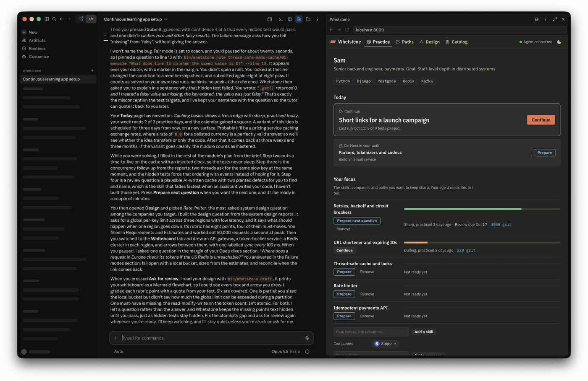

# Whetstone

[](https://github.com/boffti/whetstone/actions/workflows/ci.yml)
[](https://github.com/boffti/whetstone/actions/workflows/codeql.yml)
[](https://scorecard.dev/viewer/?uri=github.com/boffti/whetstone)
[](LICENSE)


A self-hosted practice dojo where your own AI agent builds the lessons. Pick a system you want to understand, such as a payment processor, a taxi booking service, high-frequency trading, or an LLM gateway like OpenRouter. Your agent (Claude Code, Codex, Cursor, or another) writes each step for you: a short lesson, a practical problem, and a pytest suite that grades your code. Visible tests check the basics. Hidden tests check the edge cases interviewers ask about.

This repo is the shell: the app, the CLI your agent drives, and a shared catalog of systems and real interview reports. Everything written for you stays on your machine, in `my/`, and is never committed.

<p align="center"></p>

## Quick start

```bash
git clone https://github.com/boffti/whetstone && cd whetstone
cp .env.example .env
docker compose up -d --build        # http://localhost:8000 (includes Redis)
claude                              # or codex, or open the folder in Cursor
```

If something doesn't work, run `bin/whetstone doctor`. It checks Python, your data folder and database, Redis, the web app, and that git ignores `my/`, and it says how to fix each problem.

Then ask your agent, in plain words:

- *"Set up my Whetstone profile."* It writes `my/profile.md` from what it knows about you, plus a few questions. With your consent it also reads your GitHub activity, including which code your AI co-authored, through the GitHub access your agent already has.
- *"Make me a learning path to build a checkout system."*, or pick one on the **Paths** page.
- *"Build the next question for the rate-limiter module."*
- *"I'm stuck on rate-limiter/01-token-bucket."* It guides you one step at a time and never writes your code.
- *"Review my solution"* or *"Interview me on the rate limiter."*
- *"Pair with me while I solve this."* Your agent watches your session in the background and drops short questions next to your code, like a reviewer at your shoulder. Choose how chatty it is with the Pair switch: off, quiet, coach or interviewer.

The agent follows [AGENTS.md](AGENTS.md) and five skills in `.claude/skills/` (curate, author, tutor, review, interview), and drives `bin/whetstone`. The skills follow [how Whetstone teaches](docs/PEDAGOGY.md): problem first, a mix of question types (predict, build, fix, review), a gated hint ladder, and spaced variants of what you solved. Whetstone has no AI inside, so it runs on your existing AI subscription with no API key. Every question goes through `bin/whetstone question add`, which files it only when the reference solution passes and the starter fails.

**Without Docker:** run `uv run whetstone serve`. Redis-based questions then need Redis at `REDIS_URL` (default `redis://localhost:6379/0`). On a Mac: `brew install redis && brew services start redis`.

## How it works

```
 you ──ask──▶ your AI agent ──runs──▶ bin/whetstone ──writes──▶ my/        (your profile, questions,
             (Claude Code, Codex,     (brief, new, add,                     paths, progress; private)
              Cursor, ...)             check, test)                │
                                                                   │ reads both
 contributors ──pull requests──▶ content/ (catalog, paths) ────────┴──▶ web app, localhost:8000
```

Whetstone never calls an AI itself. Your agent does the thinking, and the CLI creates and checks things.

**Side by side with your agent:** the app is built to run in a narrow browser pane next to your chat, such as Claude's built-in browser. Below 1100px it switches to one column with a full-height code editor.

## What is shared, and what is yours

| Folder | Committed | What is in it |
|---|---|---|
| `whetstone/`, `bin/`, `scripts/`, `tests/` | yes | The app, the CLI, and their tests |
| `content/catalog.yaml` | yes | About 250 modules (one topic each), with about 430 paraphrased interview reports from real companies |
| `content/paths/` | yes | About 70 learning paths: systems to build, modelled on the products of about 90 companies |
| `content/profile.example.md` | yes | The template your agent fills in |
| `examples/` | yes | Finished questions that show the format and quality bar: `memoize` (build) and `retry-tests` (write the tests) |
| `my/` | **never** | Your profile, the questions your agent built for you, your own paths, your progress, your drafts |

Whetstone reads `content/` and `my/` together, and writes only to `my/`. If you change a shared path, your copy is saved in `my/paths/` and overrides the shared one. So `git pull` brings new paths and catalog research without touching your work, and your work, which may mention your job, can't be pushed by accident. To use a different folder for your data, set `WHETSTONE_HOME`.

## Content model

- A **question** is one exercise: a lesson, a problem, hints, starter code, a reference solution, and tests. It lives in `my/tracks/<module>/<NN-slug>/`.
- A **module** is a topic made of ordered questions, each a step up from the last. It is defined in `content/catalog.yaml`, often as a placeholder with no questions yet.
- A **learning path** is an ordered list of modules toward one goal, usually a system to build:

| Domain | Examples |
|---|---|
| Payments & fintech | payment processor, checkout, wallet, crypto exchange |
| Trading & markets | high-frequency trading, matching engine, risk, backtesting |
| Marketplaces & mobility | taxi booking, meal delivery, hotel booking, flash-sale tickets |
| Social & media | news feed, short-video feed, video and music streaming |
| Messaging & collaboration | chat, video calls, collaborative docs, email |
| AI & developer platforms | an LLM gateway like OpenRouter, LLM serving, RAG, CI, SSO |
| Data & infrastructure | data warehouse, Kafka-style log, S3, databases, observability |
| Search & ads, Enterprise software, Devices & industry | search engine, maps, CRM, payroll, vehicle OTA, fab scheduling |

## Using the app

- **Catalog:** problems that companies actually ask, as compact rows you can filter by company, round and status, and browse with `/`, `j`, `k` and Enter. Each one opens to the reports: the question, follow-ups and sources.
- **Paths:** pick a system to build. Each path shows its modules as a strip. Your started paths come first, with the next step, and one request ("Fill in my path") asks your agent to build every module that is missing.
- **Practice:** your dashboard. It shows your profile, your *edges* (how sharp each skill is today; skills dull with time and stay sharp longer once mastered), what to do next, 26 weeks of practice, honest numbers, milestones, the companies you target, and recent runs. In a question:
  1. Read the **Problem**. For most questions the **Lesson** opens after your first test run, because trying first makes it stick.
  2. Write code in `solution.py`.
  3. Press **Run tests** (Ctrl/Cmd + Enter) for the visible tests, or **Submit** (Ctrl/Cmd + Shift + Enter) for all of them.
  4. If you're stuck, open hints one at a time. Each hint unlocks after a test run. The reference solution opens after you solve the question, or if you give up.

  On your first run of a question, and before each Submit, Whetstone asks you to guess which tests will pass. After a solve it asks one question about a hidden case. Both take seconds, both can be skipped, and the dashboard shows how often your guesses were right. "Stop asking" turns them off.

  A solve without the last hint or the solution counts as clean. Solved ideas come back as variants after 3 days, 3 weeks and 3 months. Your weekly streak counts weeks with 3 practice days, and forgives one missed week. Your drafts and progress are saved in `my/whetstone.db`.

## Contributing

Contributions to the shared shell are welcome: new learning paths, modules, paraphrased interview research, and app or CLI improvements. See [CONTRIBUTING.md](CONTRIBUTING.md) for formats and checks. Questions themselves are personal, so they are not contributed.

## Security

Whetstone runs the code you submit, so it only answers requests from your own machine. With Docker, it runs submissions as a non-root user in a container. See [SECURITY.md](SECURITY.md) for the threat model and how to report a vulnerability privately.

## Command line

`bin/whetstone` runs inside the Docker app when it is up, so tests run in the container. Otherwise it runs locally with `uv`.

```
bin/whetstone serve [--host 127.0.0.1] [--port 8000]
bin/whetstone doctor                                   # check the setup; says how to fix each problem

bin/whetstone path list [--domain D] [--json]
bin/whetstone path show <path> [--json]
bin/whetstone path create <id> --goal "..." [--title "..."] [--domain D] [--company C ...]
bin/whetstone path add <path> <module> [<module> ...]

bin/whetstone module create <id> [--from-catalog <problem>] [--title "..."] [--description "..."]
bin/whetstone module list [--json]

bin/whetstone question brief <module> [--topic "..."] [--difficulty medium] [--notes "..."]
bin/whetstone question new <module> <slug> [--title "..."]
bin/whetstone question add <folder> --module <module>
bin/whetstone question check [module | module/question ...]      # also: bin/whetstone validate

bin/whetstone catalog [<problem-id>] [--company X] [--round R] [--search W] [--json]
bin/whetstone progress [--json]
bin/whetstone draft <module/question>
bin/whetstone test <module/question> [--all]
bin/whetstone watch [--key K] [--for SECONDS]           # stream app activity for a pairing agent
bin/whetstone note <module/question> "..." [--line N]    # show a remark over the learner's editor

bin/whetstone generate "<topic>" [--module generated] [--difficulty medium] [--notes "..."]   # optional; needs ANTHROPIC_API_KEY
```

## License

[MIT](LICENSE). Please follow the [code of conduct](CODE_OF_CONDUCT.md) when you take part.
