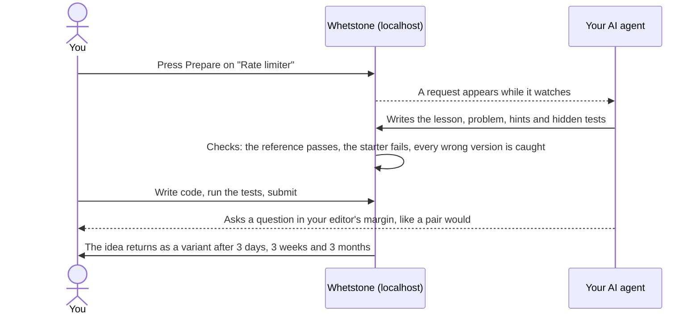

<p align="center">
  
</p>

<h1 align="center">Whetstone</h1>

<p align="center">
  <strong>Your AI writes the code. Whetstone keeps you sharp.</strong><br>
  A self-hosted practice dojo where your own AI agent builds the lessons, and real tests grade your work.
</p>

<p align="center">
  <a href="https://github.com/boffti/whetstone/actions/workflows/ci.yml"></a>
  <a href="https://github.com/boffti/whetstone/actions/workflows/codeql.yml"></a>
  <a href="https://scorecard.dev/viewer/?uri=github.com/boffti/whetstone"></a>
  <a href="LICENSE"></a>
  
  <br>
  
  
  
  <a href="CONTRIBUTING.md"></a>
</p>

<p align="center">
  <a href="#why-a-whetstone">Why</a> ·
  <a href="#sharpen-in-four-strokes">Quick start</a> ·
  <a href="#how-it-works">How it works</a> ·
  <a href="#whats-in-the-box">What's in the box</a> ·
  <a href="#where-its-going">Roadmap</a> ·
  <a href="CONTRIBUTING.md">Contributing</a>
</p>

<p align="center">
  
</p>

## Why a whetstone?

A knife that cuts every day goes dull. So do engineers.

AI now writes most of our code, and the code still ships. What quietly fades is the work it took over: recalling an idea without looking it up, reading code closely, finding a bug, writing the test that catches it, and holding a whole system in your head. You notice the day the AI is wrong and you can't tell.

Whetstone is where you put that edge back. Pick a system you'd like to understand, such as a payment processor, a matching engine, or an LLM gateway like OpenRouter. Your own AI agent (Claude Code, Codex, Cursor or another) writes each step for you, tailored to your job and your gaps. Real pytest suites grade you. Ideas you solve come back as fresh variants until they stick.

It isn't interview cramming. Real interview reports keep the problems honest, but the goal is the engineer you are at work on a Tuesday.

### What dulls, and how Whetstone hones it

| What your AI does for you | What you practise in Whetstone |
|---|---|
| Writes the code | **Build** questions: the problem comes first; the lesson opens after your first try |
| Explains code you didn't write | **Predict** questions: read working code and say what it does before you run it |
| Finds the bug | **Fix** questions: a bug report with symptoms, never the cause |
| Reviews its own pull request | **Review** questions: spot the defects planted in plausible AI-written code |
| Writes the tests | **Tests** questions: your tests must catch hidden bugs you never see |
| Sketches the architecture | **Design** questions: draw it on a whiteboard, and your agent grades it against a rubric |

## Sharpen in four strokes

```bash
git clone https://github.com/boffti/whetstone && cd whetstone
cp .env.example .env
docker compose up -d --build        # open http://localhost:8000
claude                              # or codex, or open the folder in Cursor
```

Then talk to your agent in plain words:

> **"Set up my Whetstone profile."** It drafts `my/profile.md` from what it knows about you and asks a few questions. With your consent, it also reads your GitHub activity, including which code your AI co-wrote, because those skills fade first.
>
> **"Watch Whetstone."** It sits in the background. Press **Prepare** anywhere in the app and it builds the question while you keep practising.
>
> **"What should I practise next?"** It reads your progress and offers two choices, reviews that are due coming first.

Something off? `bin/whetstone doctor` checks your setup and says how to fix each problem.

## How it works



**Whetstone doesn't call an AI on its own.** Your agent runs on your own subscription and drives a plain CLI (`bin/whetstone`); the app only creates, checks and grades. It needs no API keys or tokens, and it sends your work nowhere. (An optional in-app generator can use your own Anthropic API key. It is off unless you set one.)

**Built for the side pane.** The app is designed to sit in a narrow browser pane next to your agent's chat, such as the built-in browser in Claude's desktop app. It works on a full screen and on a phone too.

## What's in the box

- **78 systems to build** across 11 domains, modelled on the products of about 100 companies: payments, trading, marketplaces, social, messaging, AI platforms, data infrastructure and more.
- **256 modules** with **621 paraphrased interview reports** from 93 companies, so every problem is grounded in something real.
- **A Design page** built from 217 system design reports: answer on a whiteboard (Excalidraw), and your agent reads your drawing and grades the design point by point.
- **Your agent, in six roles:** curator, author, tutor, live pair, reviewer and mock interviewer. Each role is a skill file any agent can follow.
- **Grading you can trust.** Visible tests check the basics. Hidden tests check the edge cases. Every question comes with realistic wrong versions of its solution, one per common misconception, and Whetstone refuses the question if any of them gets past the tests.
- **A game layer that rewards mastery, not volume.** Skill edges that dull with time, spaced reviews, milestones, and a weekly streak that forgives one missed week. No points, no leaderboards, and you can hide all of it.

<details>
<summary><strong>The learning paths, by domain</strong></summary>

| Domain | Examples |
|---|---|
| Payments & fintech | payment processor, checkout, wallet, crypto exchange |
| Trading & markets | high-frequency trading, matching engine, risk, backtesting |
| Marketplaces & mobility | taxi booking, meal delivery, hotel booking, flash-sale tickets |
| Social & media | news feed, short-video feed, video and music streaming |
| Messaging & collaboration | chat, video calls, collaborative docs, email |
| AI & developer platforms | an LLM gateway like OpenRouter, LLM serving, RAG, CI, SSO |
| Data & infrastructure | data warehouse, Kafka-style log, S3, databases, observability |
| Search & ads, enterprise software, devices & industry | search engine, maps, CRM, payroll, vehicle OTA, fab scheduling |

</details>

<details>
<summary><strong>A tour of the app</strong></summary>

- **Practice** opens on **Today**: one next step and one alternative, then your focus: the skills, companies and paths you want to keep sharp, each with an edge that shows how sharp it is today.
- **Paths** shows each system as a route of modules. Filter by what suits you, what is ready now, a domain or a company. Pick a stop on a route to see every path that uses that module.
- **Design** lists the system design questions companies ask. You write the design in sections, draw it on the whiteboard, and press **Ask for review**.
- **Catalog** lists every problem and the reports behind it, most asked first. Browse with `/`, `j`, `k` and Enter.
- In a question, try first: the lesson opens after your first run. Hints unlock one rung at a time, each after another try. Before your first run, Whetstone asks you to guess which tests will pass, because predicting is how reading sticks.

</details>

## Your stuff stays yours

| Folder | Committed | What is in it |
|---|---|---|
| `whetstone/`, `bin/`, `scripts/`, `tests/` | yes | The app, the CLI and their tests |
| `content/` | yes | The shared catalog and learning paths that contributors improve |
| `examples/` | yes | Finished questions that set the quality bar for agents |
| `my/` | **never** | Your profile, the questions written for you, your paths, drafts and progress |

Your questions can mention your job, so they live only in `my/`, which git ignores. A `git pull` brings new paths and research without touching your work. The server only answers requests from your own machine, and with Docker your code runs as a non-root user in a container. To keep your data elsewhere, set `WHETSTONE_HOME`.

## Where it's going

- [x] Build, predict, fix, review, tests and design questions, with mutation-checked tests
- [x] An agent inbox and live pairing: your agent watches the app and answers in the margin
- [x] System design on a whiteboard, graded against a rubric
- [ ] **Terminal**: bash, text tools, jq and git, then the AWS CLI and Terraform, graded in a sandbox
- [ ] **More languages**: TypeScript and Go, chosen from your profile
- [ ] A hosted, read-only showcase of the catalog and paths

Have an idea? [Open an issue](https://github.com/boffti/whetstone/issues). Read [docs/PEDAGOGY.md](docs/PEDAGOGY.md) for the teaching rules every feature follows.

## Contributing

New learning paths, modules, paraphrased interview research, and app or CLI improvements are all welcome. [CONTRIBUTING.md](CONTRIBUTING.md) has the formats and the checks. Questions themselves are personal, so they stay out of the repo.

Found a security problem? Please report it privately, as [SECURITY.md](SECURITY.md) describes.

<details>
<summary><strong>Command line reference</strong></summary>

`bin/whetstone` runs inside the Docker app when it is up, so tests run in the container. Otherwise it runs locally with `uv`. Agents: start with [AGENTS.md](AGENTS.md).

```
bin/whetstone serve [--host 127.0.0.1] [--port 8000]
bin/whetstone doctor                                   # check the setup; says how to fix each problem

bin/whetstone path list [--domain D] [--json]
bin/whetstone path show <path> [--json]
bin/whetstone path create <id> --goal "..." [--title "..."] [--domain D] [--company C ...]
bin/whetstone path add <path> <module> [<module> ...]

bin/whetstone module create <id> [--from-catalog <problem>] [--title "..."] [--description "..."]
bin/whetstone module list [--json]

bin/whetstone question brief <module> [--topic "..."] [--type whiteboard] [--difficulty medium] [--notes "..."]
bin/whetstone question new <module> <slug> [--title "..."] [--type whiteboard]
bin/whetstone question add <folder> --module <module>
bin/whetstone question check [module | module/question ...]      # also: bin/whetstone validate

bin/whetstone catalog [<problem-id>] [--company X] [--round R] [--search W] [--json]
bin/whetstone progress [--json]
bin/whetstone draft <module/question>
bin/whetstone test <module/question> [--all]
bin/whetstone watch [--key K] [--for SECONDS]           # stream app activity for a pairing agent
bin/whetstone note <module/question> "..." [--line N]    # show a remark over the learner's editor
bin/whetstone grade <module/question> < grade.json       # record a system design grade against its rubric
bin/whetstone requests [--json] [--all]                  # work the learner queued in the app
bin/whetstone request claim|done|fail <id> [--result ...]

bin/whetstone generate "<topic>" [--module generated] [--difficulty medium] [--notes "..."]   # optional; needs ANTHROPIC_API_KEY
```

</details>

## License

[MIT](LICENSE). Sharpen freely.
