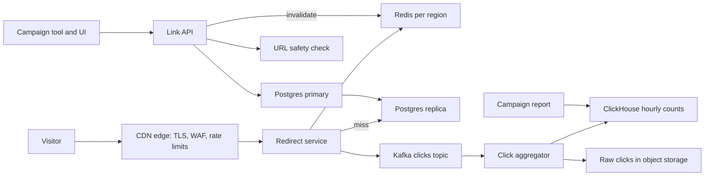
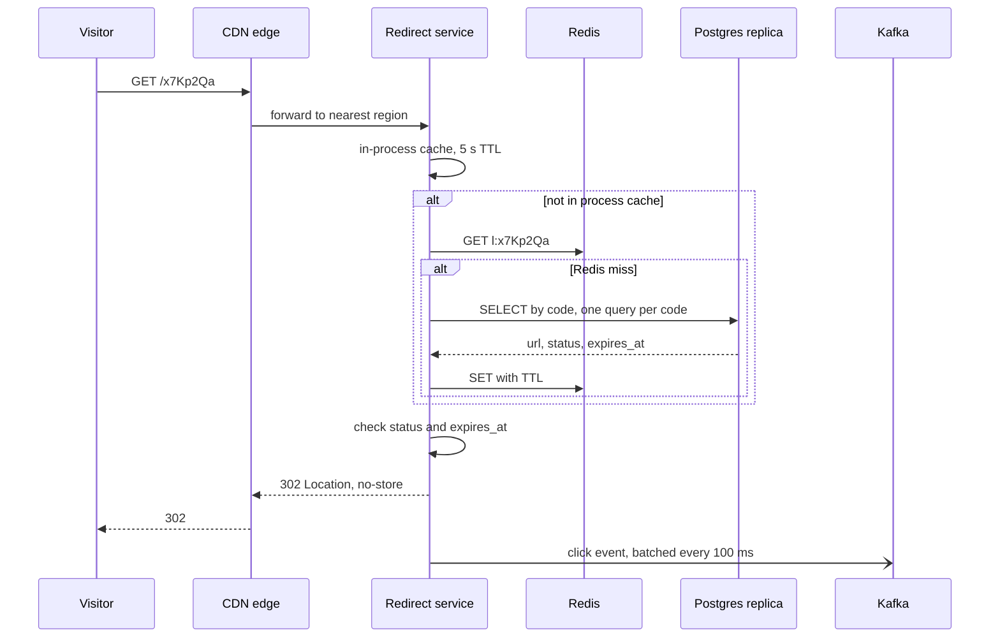

# Short links for a launch campaign

## Requirements

- Create links in the UI, or in batches of up to 10,000 from the campaign tool, with optional alias, expiry and fallback page.
- `GET /{code}` sends the visitor to the destination.
- Edits and switch-offs are live within 1 minute.
- Clicks per link, channel and hour reach the report within 5 minutes, exact enough to pay partners.
- Redirect p99 under 100 ms for the visitor, under 10 ms in our servers. Redirects 99.95% available from US and EU; creates 99.9% and may pause in a failover.
- Codes: 7 characters, never reused, not sequential.

Not doing: sign-in, report UI, QR images, outside sign-up, real bot detection.

## Estimates

- Redirects: 50 M/day ÷ 86,400 s ≈ 580/s. Launch: 20 × 580 ≈ 12,000/s; plan for 15,000/s. The TV link alone: 5,000/s.
- Creates: 1 M/day ÷ 86,400 ≈ 12/s; the 5 M batch over 2 hours ≈ 700/s. Reads to writes ≈ 50:1, 1,000:1 at launch.
- Link row ≈ 500 B with index. 100 M × 500 B = 50 GB: one database.
- Hot set: ~6 M campaign links × 300 B ≈ 2 GB, so one Redis node per region holds it.
- At a 99% hit rate the database sees 1% × 15,000 = 150 reads/s.
- At 5,000 cached redirects/s per server, peak needs 3; each region runs 4, so either region carries it alone.
- Clicks: 50 M × 200 B = 10 GB/day, ~1 TB for 90 days in object storage.
- Code space: 62^7 ≈ 3.5 × 10^12; 100 M links a year uses 0.003% of it.

## API

- `POST /v1/links` with `Idempotency-Key`: `{long_url, campaign_id, channel, alias?, expires_at?, fallback_url?}` → `201 {code, short_url}`. Errors: `400` bad URL, `409` alias taken, `422` destination not allowed, `429`.
- `POST /v1/link-batches` (≤ 10,000 rows) → `202 {batch_id}`; `GET /v1/link-batches/{id}` gives a result per row.
- `PATCH /v1/links/{code}` `{long_url?, expires_at?, status?}` → `200` or `404`.
- `GET /{code}` → `302`, `Location`, `Cache-Control: private, no-store`. Unknown → `404`. Expired or off → `302` to the fallback, else `410`.
- `GET /v1/campaigns/{id}/clicks?by=link,channel,hour` → counts.

Why 302, not 301: browsers cache a 301 forever, so repeat clicks never reach us. Counts drop, and expiry, edits and switch-off fail for anyone who clicked once. A 302 costs one request per click, and that click is the product.

## Data model

- Postgres `links`, primary in US, a replica per region: `code` primary key, `long_url`, `campaign_id`, `channel`, `status`, `expires_at`, `fallback_url`, timestamps. Index `(campaign_id, channel)` for bulk edits.
- `id_blocks`: one row, `next_start`, claimed with `UPDATE ... SET next_start = next_start + 100000 RETURNING`.
- Redis per region: `l:{code}` → `{url, status, expires_at, fallback}`, TTL = min(24 h, time to expiry).
- Kafka `clicks`: `{event_id, code, ts, channel, referrer, ua_class, visitor_hash}`, partitioned by `event_id`.
- ClickHouse `clicks_hourly` keyed by `(campaign_id, code, hour)`: count plus a HyperLogLog of visitors. Raw events in Parquet.

Codes are never deleted or reused: a printed QR code lives for years.

## High-level design

Follow: the edge ends TLS, blocks scanners and picks the nearest healthy region, without caching redirects. The redirect service tries its in-process cache, Redis, then the replica, answers, then emits the click.

Create: the Link API checks the destination, takes an ID from its block and inserts conditionally on the primary. Edits also delete the Redis key in both regions.

## Deep dives

### Short codes

- Hash of the URL: rejected. One URL needs a code per channel, and 7 hash characters clash (n²/2N ≈ 1,400 clashes at 100 M links).
- Random 7 characters plus a conditional insert: no coordination; a clash (1 in 35,000) costs a retry.
- ID blocks: each API server claims 100,000 IDs and counts locally. No clash, no retry.

I choose ID blocks. Raw counters are sequential: anyone could walk to personal links and read our volume. So each ID passes through a keyed permutation (a small Feistel cipher with cycle walking over 62^7) before base62. It is one-to-one, so codes stay unique and look random. Inserts stay conditional, so a generated code never overwrites an alias; on that clash the server takes the next ID.

### Redirect path

### Click counting

The redirect never updates a counter: it buffers the event in memory and returns. A background thread ships batches to Kafka every 100 ms, spilling to disk when Kafka is slow. The aggregator drops repeat `event_id`s within an hour, filters bots by `ua_class`, sums per code and hour, and writes every 30 s. At-least-once delivery plus dedupe gives exact counts, about a minute behind.

### Launch hour

- At 19:30 a job loads every campaign link into Redis in both regions.
- Servers scale up on a schedule, before the spike.
- The in-process cache turns the TV link's 5,000/s into one Redis read per server every 5 s.
- On a miss, one request per code goes down; the rest wait for it (single flight).
- Partitioning by `event_id` keeps the TV link off one hot Kafka partition.

### Expiry and abuse

The redirect checks `expires_at` on every request, so no cache entry outlives a link. Only staff and the campaign tool's key can create links. Destinations must match an allowlist of our domains and partners and pass a daily phishing check. Keys are rate limited and revocable. Per-IP 404 limits and cached 404s at the edge stop enumeration.

## Trade-offs

- 302 over 301: each repeat click costs a request, but counts, expiry and edits stay correct.
- ID blocks over random codes: no retries, but one more moving part and a key to protect. Random codes are the fallback.
- No CDN caching of redirects: the edge could absorb the spike, but clicks would then come from two sources to merge. Our servers carry the peak.
- One write region: conditional inserts stay strongly consistent, so no alias is taken twice. Creates pause in a failover; redirects do not.
- Async counts: a minute of lag, and a region crash loses up to 100 ms of clicks.
- Postgres over a wide-column store: 50 GB fits and queries stay simple. At billions of links I would move `links` to Cassandra.

## Failure modes

- Redis down: its replica takes over in seconds. Meanwhile servers read the Postgres replicas; hot links stay in process, so the replicas see only the long tail.
- Primary down: redirects are fine; creates return `503` and the tool retries with its `Idempotency-Key` until a replica is promoted.
- Whole database down: pre-warmed campaign links live in Redis for 24 h, so launch links work. Cold links fail.
- Region down: the CDN sends everyone to the other region, sized for full peak. Up to 100 ms of buffered clicks are lost.
- Hot key: in-process cache and single flight, as above.
- ID allocator stalls: servers fetch the next block at 50% use, so creates continue. A crashed server's unused IDs are harmless gaps. In a long outage, servers switch to random codes.
- Click pipeline down: events spill to disk and replay; the report says "delayed", never wrong.
- Retry storm: idempotency keys, client backoff with jitter, per-key edge limits.
